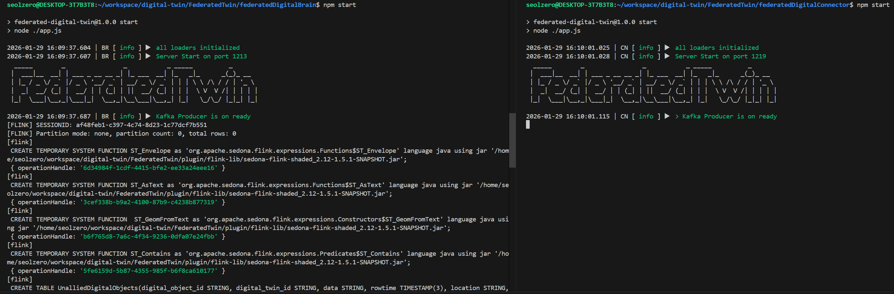

# **FederatedTwin**

Implementation of a Federated Digital Twin Platform supporting large-scale federated services
based on federated object composition and heterogeneous data processing.

The platform integrates multiple technologies including Kafka, Flink, MQTT, PostgreSQL, Airflow, and provides APIs to manage and operate Federated Digital Twins and Digital Objects.

---

# 🚀 Quick Start

### Manual Installation

```bash
git clone https://github.com/etri/FeDiT.git
```

Follow the manual installation guide

---

## Features

- Federated Digital Twin management

- Digital Object composition

- Real-time data ingestion and processing

- External data connector integration

- Stream processing using Flink

- Kafka-based data pipeline

- MQTT sensor data ingestion

- Workflow orchestration using Airflow

---

## System Architecture

FederatedTwin is composed of multiple distributed services that collaborate to manage Digital Twin data.

| Component         | Description                  |
| ----------------- | ---------------------------- |
| PostgreSQL        | Stores Digital Twin metadata |
| Kafka             | Data streaming backbone      |
| Kafka Connect     | External system integration  |
| MQTT              | Sensor data ingestion        |
| Flink             | Real-time data processing    |
| Digital Brain     | Core platform API            |
| Digital Connector | External data ingestion      |
| Airflow           | Data workflow scheduling     |

---

# Installation Guide

⚠️ **운영체제(OS)별 설치 명령어 주의**

본 문서에는 **CentOS / Ubuntu 설치 명령어가 함께 포함**되어 있습니다.  
아래 명령어 실행 전, **본인이 사용하는 운영체제에 해당하는 섹션만 실행**하시기 바랍니다.

- Ubuntu 사용자는 `[v.Ubuntu]` 표시된 명령어만 실행
- CentOS 사용자는 `[v.CentOS]` 표시된 명령어만 실행

다른 OS의 명령어(`yum`, `apt`)를 혼용하여 실행할 경우 오류가 발생할 수 있습니다.

ℹ️ **sync_engine 경로 안내**

본 문서에서 사용되는 `/sync_engine` 경로는  
프로젝트 내 `FeDiT/CDFW/synchronization_management` 디렉토리를 의미합니다.

---

## 계정생성 및 sudo 권한 부여

```bash
sudo adduser jejutp
sudo adduser jejutp sudo
## 생성한 계정으로 재로그인 진행
```

## OpenJDK 11 설치 및 JAVA_HOME설정

**[v.CentOS]**

```bash
# 설치 가능한 JDK 목록 확인 (선택 사항)
yum list java*jdk-devel

# OpenJDK 11 설치
sudo yum install -y java-11-openjdk-devel.x86_64

# OpenJDK 11 설치확인
java --version

# JAVA_HOME 설정
sudo vi /etc/profile
# 아래 내용 추가:
export JAVA_HOME=/usr/lib/jvm/java-11-openjdk-11.0.19.0.7-1.el7_9.x86_64
export PATH=$PATH:$JAVA_HOME/bin

# 설정 적용:
source /etc/profile
# JAVA_HOME 설정 확인
echo $JAVA_HOME
# 정상 출력 예:
/usr/lib/jvm/java-11-openjdk-11.0.19.0.7-1.el7_9.x86_64
```

**[v.Ubuntu]**

```bash
# OpenJDK 11 설치
sudo apt-get update
sudo apt-get install -y openjdk-11-jdk

# Java 실행 파일 경로 확인
## Java가 실제로 설치된 위치를 확인하는 단계입니다.
readlink -f $(which java)

# 예시 출력:
# /usr/lib/jvm/java-11-openjdk-amd64/bin/java
# 👉 JAVA_HOME은 /bin/java를 제외한 상위 경로입니다

# JAVA_HOME 설정
sudo vi /etc/profile

#아래 내용 추가:
export JAVA_HOME=/usr/lib/jvm/java-11-openjdk-amd64
export PATH=$PATH:$JAVA_HOME/bin

#설정 적용:
source /etc/profile

# JAVA_HOME 설정 확인
echo $JAVA_HOME

# 정상 출력 예:
#/usr/lib/jvm/java-11-openjdk-amd64
```

---

## Node.js (v16) 설치

**[v.CentOS]**

```bash
# EPEL 저장소 설치 (이미 설치되어 있어도 문제 없음)
sudo yum install -y epel-release

# Node.js 16.x 저장소 등록
curl -sL https://rpm.nodesource.com/setup_16.x | sudo bash -

# 빌드 도구 및 Node.js 설치
sudo yum install -y gcc-c++ make nodejs

# 설치 확인
node -v
npm -v
```

**[v.Ubuntu]**

```bash
curl -o- https://raw.githubusercontent.com/nvm-sh/nvm/v0.39.7/install.sh | bash

# 쉘 환경 다시 로드
source ~/.bashrc

# nvm 정상 로드 확인
export NVM_DIR="$HOME/.nvm"

# Node.js 16 설치 및 사용
nvm install 16.17.0
nvm use 16.17.0

node -v
# v16.17.0

npm -v
# 8.15.0
```

---

## PM2 설치 및 실행

```bash
sudo npm install -g pm2
pm2 install pm2-logrotate
pm2 set pm2-logrotate:max_size 10M          # 파일이 10MB 넘으면 회전
pm2 set pm2-logrotate:retain 10             # 최근 10개만 보관(나머지 삭제)
pm2 set pm2-logrotate:compress true         # 오래된 로그 gzip 압축
pm2 set pm2-logrotate:rotateInterval '0 0 * * *'   # 매일 자정에도 회전
```

**[PM2 실행 명령어 안내]**

```bash
pm2 start app.js
pm2 list
pm2 reload
pm2 stop
pm2 delete
pm2 log <procID>
pm2 flush
```

---

## MQTT (Mosquitto)

**[v.CentOS]**

```bash
$yum install -y epel-release
$yum install -y mosquitto
$systemctl start mosquitto
$systemctl enable mosquito
```

**[v.Ubuntu]**

```bash
sudo apt install -y mosquitto mosquitto-clients
sudo systemctl start mosquitto
sudo systemctl enable mosquitto
sudo systemctl status mosquitto
```

---

# **Kafka (v2.11-2.4.0)**

## 1. Kafka 다운로드 및 압축 해제

```bash
wget https://archive.apache.org/dist/kafka/2.4.0/kafka_2.11-2.4.0.tgz
tar -xvzf kafka_2.11-2.4.0.tgz

cd kafka_2.11-2.4.0/config
# config파일들 확인
ls
```

## 2. Kafka config 설정

### 2-1. 서버 IP 및 pluginpath 확인

- 아래 명령어로 Kafka가 실행 중인 서버의 IP 주소를 확인합니다.

```bash
hostname -I
```

예시 출력:

```bash
192.168.145.13
```

- 아래 명령어로 Kafka plugin 주소를 확인합니다. (**확인 후 복사**)

```bash
realpath FeDiT/CDFW/synchronization_management/plugin/kafka-connector/
```

예시 출력:

```bash
/home/jejutp/FeDiT/CDFW/synchronization_management/plugin/kafka-connector
```

### 2-2. connecter 설정 (config/connect-distributed.properties)

```bash
cd kafka_2.11-2.4.0/config
vi connect-distributed.properties
```

> 아래 설정에서 aaa.bbb.ccc.ddd 부분을
> 위에서 확인한 서버의 실제 IP 주소로 변경하세요

```properties

rest.host.name=aaa.bbb.ccc.ddd
rest.port=8083
rest.advertised.host.name=aaa.bbb.ccc.ddd
rest.advertised.port=8083
connector.client.config.override.policy=All
consumer.auto.offset.reset=latest
#복사한 plugin 주소 붙여넣기
plugin.path=/home/jejutp/FeDiT/CDFW/synchronization_management/plugin/kafka-connector
```

> ⚠️ **중요**
> plugin.path 경로에는 아래의 안내에 따라 직접 빌드한 커스텀 커넥터 JAR들이 위치해야 합니다.

## 2-3. Broker 설정 (config/server.properties)

```bash
vi kafka_2.11-2.4.0/config/server.properties
```

```properties
# server.properties 파일 수정(주석제거 및 주소입력)

listeners=PLAINTEXT://:9092
advertised.listeners=PLAINTEXT://aaa.bbb.ccc.ddd:9092
```

## 3. 커넥터 디렉토리 구조

```bash
/FeDiT/CDFW/synchronization_management/connector/
 ├── jdbc-connector-for-apache-kafka/
 ├── kafka-http-mqtt-connetor/
 └── kafka-sink-connector/
```

각 디렉토리는 Gradle 기반이며 JAR 빌드 후 connect-distributed.properties에 지정한 plugin.path로 이동해야 합니다.

## 4. 커넥터 빌드 및 JAR 배치

### 4-1) 커넥터 빌드

> ⚠️ gradlew: Permission denied는 wrapper 실행권한 문제 — chmod +x gradlew로 해결 가능

```bash
# plugin 폴더 확인
ls FeDiT/CDFW/synchronization_management/plugin/kafka-connector
# 없으면 생성
mkdir FeDiT/CDFW/synchronization_management/plugin/kafka-connector

# Connector 폴더 확인
cd FeDiT/CDFW/synchronization_management/connector/
ls
# ls 결과 예시
jdbc-connector-for-apache-kafka  kafka-http-mqtt-connetor  kafka-sink-connector

# JDBC Connector
cd jdbc-connector-for-apache-kafka
./gradlew clean build

# HTTP/MQTT Connector
cd ../kafka-http-mqtt-connetor
./gradlew clean build

# Sink Connector
cd ../kafka-sink-connector
./gradlew clean build
```

### 4-2) 빌드된 JAR 파일 이동

```bash
# 위치 이동
cd FeDiT/CDFW/synchronization_management
# 빌드 성공 후 생성된 jar파일 복사
cp connector/jdbc-connector-for-apache-kafka/build/libs/*.jar plugin/kafka-connector/

cp connector/kafka-http-mqtt-connetor/build/libs/*.jar plugin/kafka-connector/

cp connector/kafka-sink-connector/build/libs/*.jar plugin/kafka-connector/

# plugin path에 복사완료된 jar파일 확인
ls plugin/kafka-connector
```

## 5. PostgreSQL JDBC 드라이버 추가

```bash
cd ~/kafka_2.11-2.4.0/libs/
wget https://jdbc.postgresql.org/download/postgresql-42.5.1.jar
```

---

# **Flink (v1.17.0)**

## 1. Flink 다운로드

```bash
cd ~
wget https://archive.apache.org/dist/flink/flink-1.17.0/flink-1.17.0-bin-scala_2.12.tgz
tar -xvzf flink-1.17.0-bin-scala_2.12.tgz
```

## 2. Flink 라이브러리 세팅

### 2-1) 기본 라이브러리 복사

```bash
cd flink-1.17.0/lib
# 확인
ls
cp ~/FeDiT/CDFW/synchronization_management/plugin/flink-lib/* .
```

복사되는 파일:

- flink-connector-files-1.17.0.jar
- flink-sql-connector-kafka-1.17.0.jar
- kafka-clients-3.4.0.jar
- postgresql-42.6.0.jar
- flink-connector-jdbc-3.1.0-1.17.jar
- flink-json-1.17.0.jar

### 2-2) Sedona Flink 라이브러리 추가

```bash
wget https://repo1.maven.org/maven2/org/apache/sedona/sedona-flink-shaded_2.12/1.5.1/sedona-flink-shaded_2.12-1.5.1.jar
wget https://repo1.maven.org/maven2/org/datasyslab/geotools-wrapper/1.5.1-28.2/geotools-wrapper-1.5.1-28.2.jar
```

> ⚠️ 반드시 위에서 설치한 `flink-1.17.0/lib/`에 위치

## 3. flink-conf.yaml 설정

```bash
cd ../conf/
vi flink-conf.yaml
```

- 주석제거 및 주소입력

> 아래 설정에서 `aaa.bbb.ccc.ddd`는  
> **Flink JobManager가 실행되는 서버의 IP 주소**로 변경해야 합니다.

```yaml
taskmanager.numberOfTaskSlots: 16

rest.port: 8081
rest.address: aaa.bbb.ccc.ddd
rest.bind-address: aaa.bbb.ccc.ddd

# 추가
sql-gateway.endpoint.type: rest
sql-gateway.endpoint.rest.address: aaa.bbb.ccc.ddd
sql-gateway.endpoint.rest.port: 8087
sql-gateway.session.idle-timeout: 0

rest.flamegraph.enabled: true
```

## 4. /etc/profile 환경 변수 설정

```bash
export FLINK_HOME=$HOME/flink-1.17.0
export PATH=$PATH:$FLINK_HOME/bin
```

```bash
source /etc/profile
source ~/.bashrc
```

## 5. Flink 클러스터 구성 (선택 사항. 필수 아님)

- 모든 노드 동일 경로 설치
- master 노드에서 `masters`, `workers` 파일 설정
- `flink-conf.yaml` 모든 노드 동일
- 필요한 포트

| Port | Description     |
| ---- | --------------- |
| 6123 | JobManager RPC  |
| 8081 | Flink Dashboard |
| 8087 | SQL Gateway     |

SSH 무패스 설정 필요.

포트 확인:

```bash
sudo netstat -lntp | grep 8081
or
ss -lntp | grep 8081
```

---

# **Postgres (v12)**

## 1. Max open files 설정

> PostgreSQL은 동시에 많은 파일/프로세스를 사용할 수 있으므로
> OS 레벨에서 파일 디스크립터 제한을 늘려야 합니다.

```
cd ~
sudo vi /etc/security/limits.conf

# 아래 내용 추가:
postgres soft nofile 65535
postgres hard nofile 65535
postgres soft nproc 65535
postgres hard nproc 65535
```

## 2. 의존 패키지 설치

**[v.CentOS]**

```bash
yum install -y gcc gcc-c++ make autoconf readline readline-devel zlib zlib-devel openssl openssl-devel gettext gettext-devel python python-devel wget
```

## 3. 설치 및 초기화

**[v.CentOS]**

```bash

sudo yum install -y https://download.postgresql.org/pub/repos/yum/reporpms/EL-7-x86_64/pgdg-redhat-repo-latest.noarch.rpm
sudo yum install -y postgresql12-server

sudo /usr/pgsql-12/bin/postgresql-12-setup initdb
systemctl enable postgresql-12
systemctl start postgresql-12
systemctl status postgresql-12
```

**[v.Ubuntu]**

```bash
sudo apt update
sudo apt install -y postgresql-14 postgresql-client-14

sudo systemctl start postgresql
sudo systemctl enable postgresql
sudo systemctl status postgresql
```

## 4. 외부 접속 허용

**[v.CentOS / Ubuntu 공통]**

- postgresql.conf 수정

```bash
 sudo vi /etc/postgresql/14/main/postgresql.conf
```

```conf
listen_addresses = '*'
port = 5432
```

- pg_hba.conf 수정

```bash
sudo vi /etc/postgresql/14/main/pg_hba.conf
```

```conf
host    all             all             0.0.0.0/0               scram-sha-256
```

```bash
sudo systemctl restart postgresql
```

## 5. 비밀번호 설정 및 DB 생성

```bash
sudo -u postgres psql
```

```sql
ALTER USER postgres PASSWORD '<passwd지정>';
\q

# 예) ALTER USER postgres PASSWORD 'keti123';
```

## 6. Database 생성 및 Dump 파일 Import

```bash
cp ~/FeDiT/CDFW/synchronization_management/import/federated_digital_twin-dump.sql /tmp/

sudo -u postgres psql -f /tmp/federated_digital_twin-dump.sql
```

> ⚠️ 만약 dump파일을 잘못 사용해서 테이블이 엉켰다면 디비 삭제후 import 재실행
> DROP DATABASE federated_digital_twin WITH (FORCE);

---

## nginx 설치 및 세팅

```
# 설치
cd ~
sudo apt update
sudo apt install nginx

# 설치 시 에러 주의 (nginx: [emerg] socket() [::]:80 failed (97: Address family not supported by protocol))
# 이는 IPv6를 지원하지 않는 서버인데 nginx가 IPv6([::]:80)로 바인딩하려고 해서 발생한 오류입니다.
 -  먼저 아래 명령을 실행해주세요.
grep -R "\[::\]" /etc/nginx

 - 아마 다음과 같은 결과가 나올 것입니다.
/etc/nginx/sites-available/default:listen [::]:80 default_server;
/etc/nginx/sites-available/default:listen [::]:80;

# IPv6 listen 제거
 - 편집기를 엽니다.
sudo vi /etc/nginx/sites-available/default

 - 다음 두 줄을 찾아 삭제하거나 앞에 #를 붙여 주석 처리합니다.
listen [::]:80 default_server;
listen [::]:80;

 - 최종적으로는 아래처럼 남아있으면 됩니다.
server {
    listen 80 default_server;
    # listen [::]:80 default_server;

    root /var/www/html;
}

# listen 처리 후 재설치 진행
sudo apt install nginx


# 설정 검사
sudo nginx -t

 - 정상이라면 아래와 같이 출력됩니다
syntax is ok
test is successful

# 설치 마무리
sudo apt --fix-broken install

# 서비스 시작
sudo systemctl restart nginx

# 상태 확인
sudo systemctl status nginx

# nginx.conf 파일 찾기 (보통 /etc/nginx/nginx.conf)
sudo find / -name nginx.conf

- FeDiT/CDFW/synchronization_management/import/nginx.conf 사용
# 기존 nginx.conf 백업
sudo cp /etc/nginx/nginx.conf /etc/nginx/nginx.conf.bak

# 새 nginx.conf 복사
sudo cp FeDiT/CDFW/synchronization_management/import/nginx.conf /etc/nginx/nginx.conf

# IP 주소 변경 (외부 주소에 nginx로 진입하는 주소 작성)
sudo sed -i 's/220\.124\.222\.84/외부 주소/g' /etc/nginx/nginx.conf
# 예시) sudo sed -i 's/220\.124\.222\.84/220.124.222.98/g' /etc/nginx/nginx.conf

# 변경이 제대로 되었는지 확인하려면
grep -n "외부 주소" /etc/nginx/nginx.conf
# 예시) grep -n "220.124.222.98" /etc/nginx/nginx.conf


# 문법 검사
sudo nginx -t

# 서비스 시작
sudo systemctl restart nginx
sudo systemctl status nginx
```

---

# **Execution**

## kafka 실행

```bash
cd ~/kafka_2.11-2.4.0
# zookeeper 실행
bin/zookeeper-server-start.sh -daemon config/zookeeper.properties
# kafka 실행
bin/kafka-server-start.sh -daemon config/server.properties
# kafka-connector 실행
bin/connect-distributed.sh -daemon config/connect-distributed.properties
```

## Flink 실행

```bash
cd ~/flink-1.17.0

# 클러스터 실행
bin/start-cluster.sh

# SQL Gateway 실행
bin/sql-gateway.sh
```

---

## Java Process 확인

```bash
jps
```

예시:

```
Jps
QuorumPeerMain
Kafka
ConnectDistributed
TaskManagerRunner
StandaloneSessionClusterEntrypoint
SqlGateway
```

---

# **federatedDigitalBrain/federatedDigitalConnector 설정**

### ⚙️ 환경 설정 (.env.node)

ℹ️ **.env.node 작성 안내**
프로젝트 루트 경로에 `.env.node` 파일을 생성하여 환경 설정값을 작성할 수 있습니다.

`.env.node` 파일이 존재하지 않거나 특정 값이 정의되지 않은 경우,
시스템은 **기본 설정값(default configuration)** 으로 실행됩니다.

**📁 File Location**

`.env.node` 파일의 프로젝트 루트 위치 확인

```
synchronization_management
├── .env.node
├── federatedDigitalBrain
├── federatedDigitalConnector
└── ...
```

**🌐 서버 IP 주소 설정**

설정 파일 곳곳에 등장하는 `aaa.bbb.ccc.ddd` 값은  
**현재 서버의 실제 IP 주소로 반드시 변경해야 합니다.**

> 서버가 **1대일 경우 `localhost` 사용 가능**

⚠️ Kafka / Flink / PostgreSQL 서버가 각기 다른 서버에 있다면 `host` 값을 **해당 서버의 IP 주소로 변경해야 합니다.**

**Example**

```env
POSTGRES_HOST=localhost
POSTGRES_PORT=5432
POSTGRES_USER=postgres
POSTGRES_PASSWORD=keti123 #<postgresql설정 시 지정한 비밀번호 작성>

AIRFLOW_ADMIN_USERNAME=admin
AIRFLOW_ADMIN_PASSWORD=admin1234
AIRFLOW_ADMIN_EMAIL=admin@example.com

KAFKA_HOST=localhost:9092
KAFKA_CONNECT_HOST=aaa.bbb.ccc.ddd:8083

MQTT_HOST=localhost
MQTT_PORT=1883

FLINK_GATEWAY_HOST=localhost:8087
FLINK_GATEWAY_HOSTNAME=localhost
FLINK_GATEWAY_PORT=8087
FLINK_TOTAL_ROWS=0
FLINK_SCAN_PARTITION_NUM=0
FLINK_PARTITION_MODE=none

SEDONA_JAR_PATH=<sedona jar파일 위치 작성>

KAFKA_EXTERNAL_HOST=localhost
KAFKA_EXTERNAL_PORT=19092

UPLOAD_FOLDER=visual-model-assets/
UPLOAD_MAX_SIZE=100 * 1024 * 1024
```

**⚠️ Sedona JAR 위치 찾기 참고**

```bash
# Flink lib:
ls $FLINK_HOME/lib | grep sedona

# FLINK_HOME 설정이 안됐을 경우 직접 찾기
realpath flink-1.17.0/lib/sedona-flink-shaded_2.12-1.5.1.jar
```

---

## 패키지 설치 (Brain / Connector)

```bash
cd ~/FeDiT/CDFW/synchronization_management/import
npm i kafkajs axios

cd ../federatedDigitalBrain
npm install

cd ../federatedDigitalConnector
npm install

```

## 동기화 엔진 실행

```bash
pm2 start federatedDigitalBrain/app.js
pm2 start federatedDigitalConnector/app.js
cd ../import
pm2 start dataModelRegistrationFromKafkaConsumer.js
```

- 실행 화면 예시
  

## Web 실행

```bash
cd FDT_Monitoring_WEB
npm i
pm2 start "npm run dev" --name FDT_Monitoring_WEB
```
