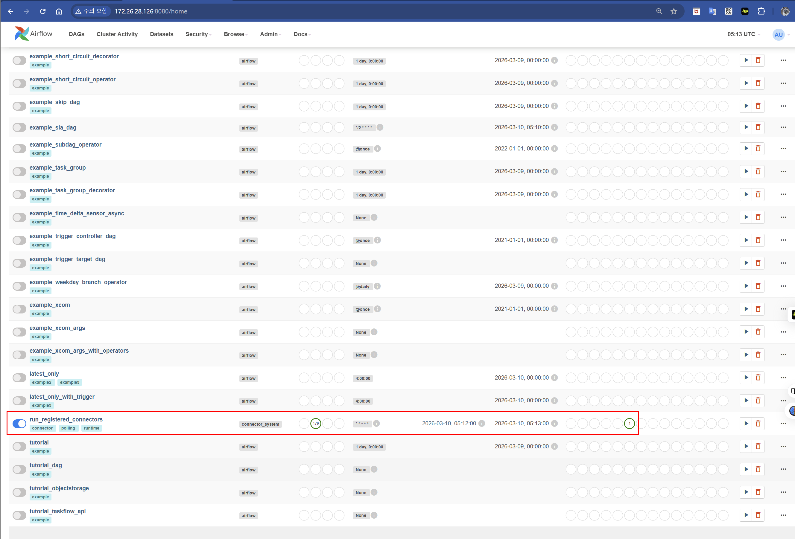
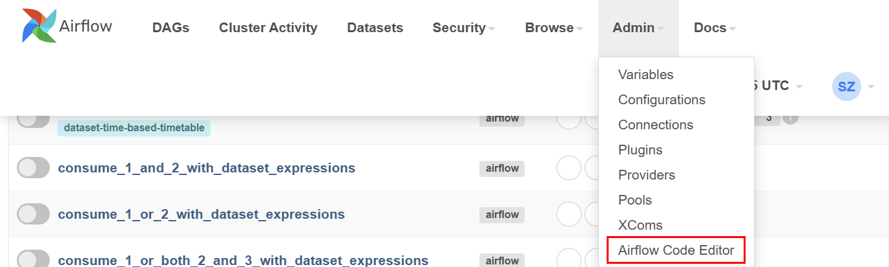
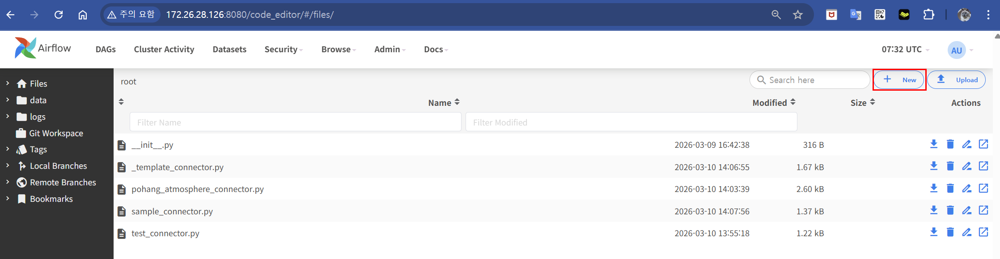
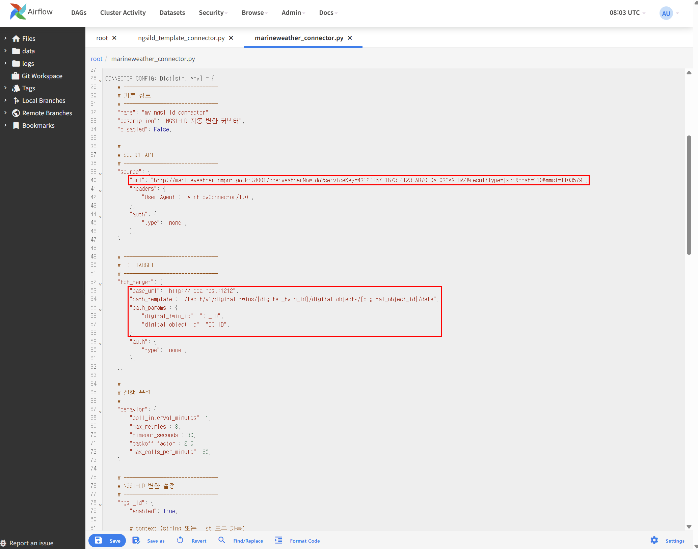
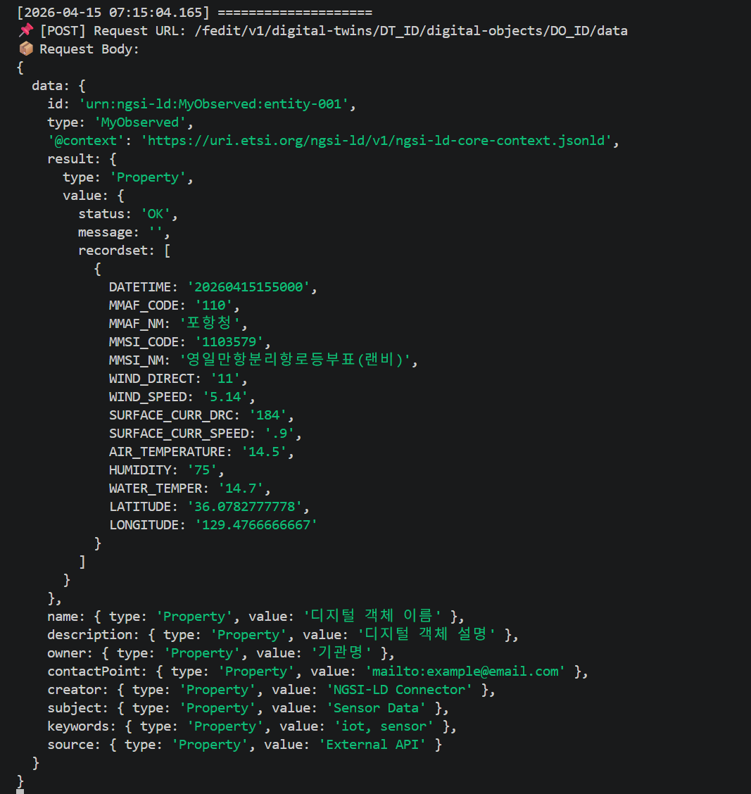
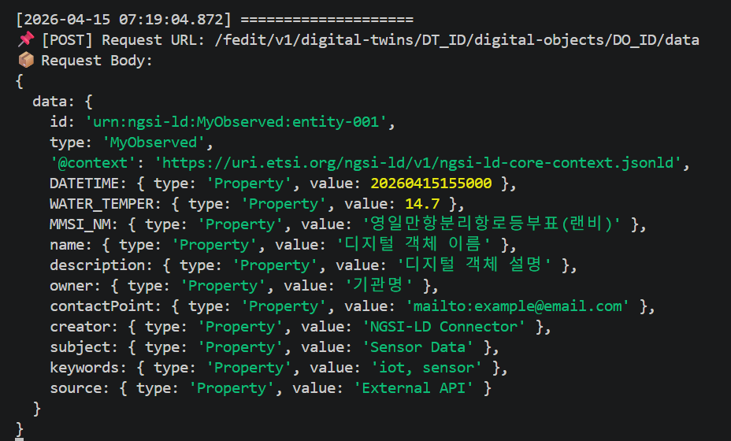

# Airflow 자동 폴링 커넥터 런타임 - 상세 퀵스타트

자동으로 여러 데이터 소스에서 주기적으로 데이터를 수집하고 FDiT 플랫폼으로 전송하는 Airflow 기반 시스템

## ✨ 주요 기능

- **자동 스캔**: `plugins/user_connectors` 에서 커넥터 파일을 자동으로 찾아 실행
- **유연한 인증**: none, query, header, bearer, basic 지원
- **보안**: URL의 inline secret (serviceKey 등)을 로그에서 redact
- **안정성**: 재시도, exponential backoff, 타임아웃 관리
- **Rate Limiting**: 분당 최대 호출 수 제한
- **상태 관리**: Airflow Variable을 이용한 다음 실행 시간 추적
- **타이핑**: Python 3.10+ 타입 힌트 포함

## 📁 디렉토리 구조

```
airflow/
├── dags/
│   └── run_registered_connectors.py     # 메인 DAG (1분마다 실행)
└── plugins/
    ├── connector_runtime/               # 런타임 패키지
    │   ├── __init__.py
    │   ├── loader.py      # 커넥터 파일 로더
    │   ├── registry.py    # 커넥터 레지스트리
    │   └── runner.py      # 커넥터 실행 엔진
    └── user_connectors/               # 사용자 커넥터들
        ├── __init__.py
        ├── _template_connector.py    # 템플릿
        └── pohang_atmosphere_connector.py  # 예제
```

## 📁 주요 디렉터리 설명

### `dags/`

- **run_registered_connectors.py**: 메인 Airflow DAG 파일입니다. 1분 간격으로 실행되며, `connector_runtime` 패키지를 이용해 등록된 커넥터를 스캔·로드·실행합니다. 결과를 로그에 남기고 실패 시 재시도합니다.

### `plugins/connector_runtime/`

커넥터 런타임의 핵심 로직이 담긴 패키지.

- `__init__.py`: 패키지 초기화 파일. 필요에 따라 패키지 전역 변수를 정의하거나 버전을 표시할 수 있습니다.

- **loader.py**: `ConnectorLoader` 클래스를 제공하며, `plugins/user_connectors` 디렉터리에서 `*_connector.py` 패턴에 맞는 파일을 찾고 다음을 수행합니다:
  - `scan_connectors()`: 디렉터리를 스캔하고 발견된 파일 목록을 반환
  - `load_connector_config()`: 각 파일에서 `CONNECTOR_CONFIG` 딕셔너리를 로드
  - `load_transform_function()`: `transform_source_data()` 함수를 불러옴
  - `load_all()`: 위 과정을 종합하여 실제 사용할 커넥터들을 딕셔너리 형태로 반환
    상세 로깅과 에러 처리로 스캔/로딩 상태를 기록합니다.

- **registry.py**: 커넥터 메타데이터를 관리하는 간단한 레지스트리입니다. 런타임 중 커넥터를 등록하고 조회하기 위해 사용됩니다. 다음 메서드가 존재합니다:
  - `register(connector_id, config, transform_func)`
  - `get(connector_id)`
  - `get_all()`
  - `list_connector_ids()`

- **runner.py**: 커넥터 실행 엔진. `ConnectorRunner` 클래스가 핵심이며, 아래 기능을 포함합니다:
  - 폴링 스케줄 관리(`_is_due`, `_update_next_run_time`)
  - 소스 데이터 가져오기(`_fetch_data`) – 인증, 재시도, 타임아웃, 레이트 리밋 적용
  - 데이터 변환(`_transform_data`) – 커넥터의 `transform_source_data` 호출
  - FDiT 플랫폼 전송(`_send_to_fdt`) – endpoint 구성, 인증, 에러 로깅
  - 실행 결과 정리 및 반환 (`run()`)

  보안: `SecretRedactor`가 URL/헤더/딕셔너리 내 민감정보를 자동으로 마스킹
  인증: 다양한 방식(`none`, `query`, `header`, `bearer`, `basic`)
  상태: 마지막 요청 상태 코드 `last_fetch_status`를 추적하여 오류 코드 전달

### 인증 타입 (auth.type)

- **none**: 인증 없음
- **query**: 쿼리 파라미터 (serviceKey 등)
- **header**: HTTP 헤더
- **bearer**: Bearer Token
- **basic**: Basic Authentication

### 폴링 스케줄 관리

- DAG 스케줄: 1분마다 실행
- 커넥터별 스케줄: `poll_interval_minutes` 로 제어
- 상태 저장: Airflow Variable `connector_{id}_next_run_at`

### 🧠 NGSI-LD 자동 변환

ngsi_ld.enabled = True이면 공통 runtime이 데이터를 NGSI-LD 형식으로 자동 변환합니다.

**기본 설정**

```python
"ngsi_ld": {
    "enabled": True,
    "context": "https://uri.etsi.org/ngsi-ld/v1/ngsi-ld-core-context.jsonld",
    "entity": {
        "type": "MyObserved",
        "id_pattern": "urn:ngsi-ld:{type}:entity-001"
    }
}
```

### `plugins/user_connectors/`

사용자가 직접 작성하는 커넥터 모듈들이 위치합니다.

- `__init__.py`: 패키지 식별, 초기화 수행.
- **ngsild_template_connector.py**: 새로운 커넥터를 작성할 때 복사해서 사용하는 템플릿.
- **marineweather_connector.py**: 포항 대기오염 데이터를 수집하는 실제 커넥터. Inline serviceKey를 사용한 query 인증, 변환 함수 포함.

각 커넥터에는 반드시 다음이 포함되어야 합니다:

- CONNECTOR_CONFIG (필수)
- transform_source_data 함수 (필수)

단, 대부분의 경우 transform_source_data는 직접 구현하지 않고 공통 runtime 함수를 사용하며 특수한 변환이 필요한 경우에만 직접 구현합니다

```python
def transform_source_data(data, context):
    return transform_with_config(data=data, context=context, config=CONNECTOR_CONFIG)
```

👉 커넥터 생성 및 상세 작성 방법은 CREATE_CONNECTOR.md 문서를 참고하세요.

## 🚀 사용 흐름

1. Airflow가 `run_registered_connectors` DAG를 1분마다 실행.
2. DAG 내부 `load_and_run_connectors()` 호출.
3. `ConnectorLoader`가 `user_connectors` 스캔 및 로드.
4. 로드된 커넥터들 중 `disabled=False`인 것만 선별.
5. 각 커넥터마다 `_is_due()`로 다음 실행 여부 판정.
6. 구동 대상이면 `ConnectorRunner`로 데이터를 가져오고 변환 후 FDiT로 전송.
7. 각 단계에서 상세 로그 출력 및 Airflow Variable에 다음 실행 시간 저장.
8. DAG 실행이 끝나면 요약 로그가 기록됨.

## 📋 파일별 주요 함수/클래스 요약

### run_registered_connectors.py

- `load_and_run_connectors(**context)` – DAG의 PythonOperator에서 호출.
- 마지막에 `run_connectors_task = PythonOperator(...)`로 작업 등록.

### connector_runtime/loader.py

- `ConnectorLoader.find_connector_dir()` – 탐색 우선순위: AIRFLOW_HOME → cwd → 플러그인 상대 경로.
- `scan_connectors()`, `load_connector_config()`, `load_transform_function()`, `load_all()`.

### connector_runtime/runner.py

- `SecretRedactor` : 로그에 민감정보 마스킹.
- `RateLimiter` : 요청 속도 제한.
- `AuthHandler` : 인증 정보 추출 및 적용.
- `ConnectorRunner.run()` : 전체 실행 프로세스.

### connector_runtime/registry.py

- 클래스 메서드로 커넥터 등록/조회/목록 제공.

## ⚙️ 설정 옵션

### behavior 딕셔너리

| 옵션                    | 설명                     | 기본값 |
| ----------------------- | ------------------------ | ------ |
| `poll_interval_minutes` | 폴링 간주 (분)           | 5      |
| `max_retries`           | 최대 재시도 횟수         | 3      |
| `timeout_seconds`       | HTTP 타임아웃 (초)       | 30     |
| `backoff_factor`        | Exponential backoff 계수 | 2.0    |
| `max_calls_per_minute`  | Rate limit               | 60     |

## 🛠 디버깅 팁

- 로그 레벨을 DEBUG로 올리면 로더/러너의 각 단계가 표시됩니다.
- Airflow 웹 UI에서 변수(`connector_{id}_next_run_at`)를 열어 스케줄 상태 확인.
- `ConnectorRunner.last_fetch_status`가 결과 딕셔너리에 포함되어 HTTP 오류코드를
  볼 수 있습니다.

## 📚 추가 참조

- 이 프로젝트는 Airflow 2.5+, Python 3.10+ 기반입니다.
- 커넥터 구조를 확장하려면 `connector_runtime` 내부 클래스를 상속하거나
  추가 헬퍼 함수를 작성할 수 있습니다.
- 추후 사용자 인증 방식이나 전송 포맷을 바꾸려면 `runner.py` 의
  `_fetch_data` 및 `_send_to_fdt`를 수정하십시오.

---

## 🚀 실제 사용 예시

### 1. aiflow 실행 후 (명령어: airflow webserver -p 8080, airflow scheduler)

### 2. web 접속(localhost:8080)

### 3. run_registered_connectors dag 실행



### 4. Admin탭에서 Airflow Code Editor를 통해 창 이동



### 5. web에서 파일 작성 (반드시 \*\_connector.py 형태로 파일 이름 저장)



### 6. {connector_name}\_connector.py파일을 저장 후 url로부터 get해온 데이터를 endpoint로 전송하는 커넥터가 자동으로 인식되기를 기다림

> ⚠️CREATE_CONNECTOR.md 문서참고해서 config 작성



### 7. endpoint측에서 데이터를 받는 것을 확인할 수 있음.

- attributes 설정 안한 버전
  

- attributes 설정 버전
  
