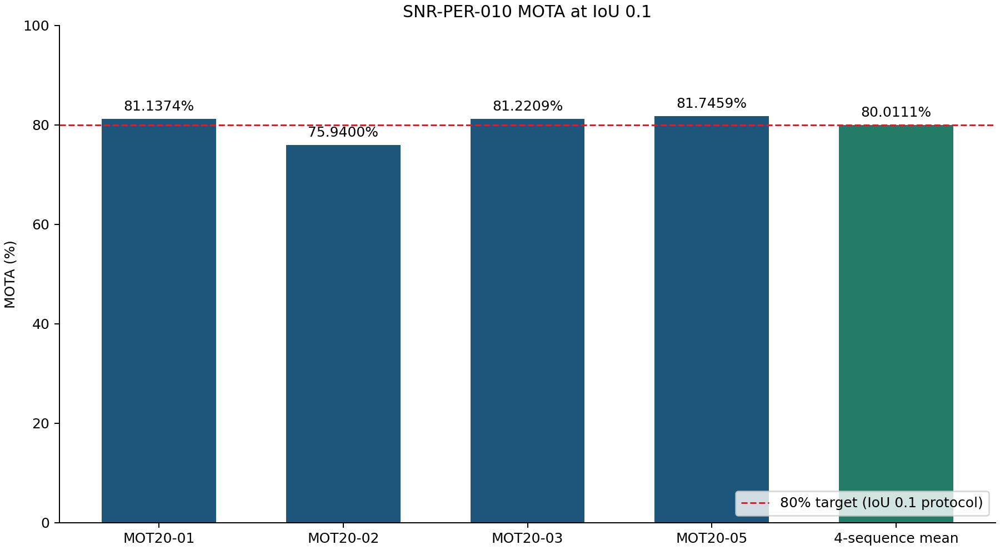

# SNR-PER-010 추론 및 성능평가

MOT20 네 시퀀스의 영상 프레임을 제공된 사전학습 모델로 추론하고 TrackEval로 MOTA와 IDF1을 계산합니다. 모델 가중치는 변경하지 않습니다.

서버의 네 시퀀스 재현 결과는 **평균 MOTA 80.011059%**입니다(IoU 0.1). 실행 결과와 입력 검증 자료는 `results/verification/`에, 표와 그래프를 포함한 실행 출력은 노트북에 저장했습니다.



Python 3.11과 NVIDIA CUDA 환경을 사용합니다. Grounding DINO 가중치는 64 MiB 단위 파일로 저장됩니다. 추론 전에 자동으로 결합하고 원본 SHA-256을 검증합니다.

신경망 추론은 FP32로 실행하며 CUDA 행렬 연산과 cuDNN의 TF32를 비활성화합니다. OSNet 특징 추출 배치 크기는 600입니다.

서버 JupyterLab의 Terminal에서 다음 명령으로 시험 브랜치를 새 폴더에 clone합니다. 비공개 저장소 접근 권한을 가진 GitHub 계정으로 Git 인증을 먼저 완료합니다.

```bash
cd /home/jovyan
git clone --branch OPFW_development_ETRI_pman --single-branch https://github.com/etri/FeDiT.git snr-per-010-clone
cd snr-per-010-clone/OPFW/ml_prediction_manager_v2/example/snr_per_010
git rev-parse HEAD
```

아래 명령은 GitHub에서 받은 소스와 모델만으로 새로운 작업 폴더에서 전체 추론을 수행합니다. 데이터셋은 MOTChallenge 공식 배포처에서 다운로드합니다. 이전 실행 폴더나 검출·특징 캐시를 지정하지 않습니다.

예측매니저의 `snr-per-010-mot20-inference:v2.0` 또는 `v3.0` 이미지에는 고정된 실행 환경과 `SNR-PER-010 (CUDA)` 커널이 포함돼 있습니다. 이 이미지에서는 다음 명령을 실행합니다.

```bash
/opt/snr010-env/bin/python prepare_weights.py
/opt/snr010-env/bin/python download_dataset.py --workspace workspace
/opt/snr010-env/bin/python verify_inputs.py --workspace workspace
/opt/snr010-env/bin/python run_inference.py --workspace workspace --run-name clone-inference
```

다른 Python 3.11 CUDA 환경에서 새 가상환경을 구성할 때는 다음 명령을 사용합니다.

```bash
python -m venv .venv
.venv/bin/python -m pip install numpy==2.4.4 Cython==3.2.4 setuptools wheel
.venv/bin/python -m pip install -r requirements.txt
.venv/bin/python -m pip install --force-reinstall --no-deps --no-build-isolation --no-binary=cython_bbox cython_bbox==0.1.5
.venv/bin/python -m pip install --force-reinstall --no-deps lap==0.5.13
.venv/bin/python download_dataset.py --workspace workspace
.venv/bin/python verify_inputs.py --workspace workspace
.venv/bin/python run_inference.py --workspace workspace --run-name inference
```

같은 실행 이름으로 다시 실행하면 저장된 프레임과 완료 단계를 이어서 처리합니다. 전체 추론을 새로 수행하려면 다른 실행 이름을 사용합니다.

같은 서버에서 생성한 동결 백본 캐시를 사용할 때는 다음과 같이 실행합니다. 입력 이미지 8,931개와 백본 모델의 SHA-256을 대조한 후 Grounding DINO 검출 및 OSNet 특징을 재사용하고, 보정 모델 추론·추적·후처리·평가를 다시 수행합니다.

```bash
.venv/bin/python run_inference.py --workspace workspace --run-name verification --reuse-backbone-cache /path/to/backbone-cache-run
```

JupyterLab에서는 같은 환경에 커널을 등록한 후 노트북을 실행합니다.

```bash
.venv/bin/python -m ipykernel install --user --name snr-per-010-image --display-name "SNR-PER-010 (CUDA)"
```

노트북 파일은 `SNR-PER-010_추론_성능평가.ipynb`입니다. 노트북 기본 실행은 `clone-inference`이며 기존 실행 캐시를 사용하지 않습니다. 이전 실행의 출력이 없는 상태에서 시작합니다. 데이터셋이 이미 준비돼 있으면 시퀀스별 프레임 존재 여부를 확인하고 저장된 자료를 사용합니다.

추론은 Grounding DINO 사람 후보 생성, OSNet 특징 추출, fold별 보정 모델, ByteTrack, 학습 기반 추적 필터와 연결, 보간 및 누락 구간 보정 순서로 수행됩니다. 각 시퀀스에는 해당 시퀀스를 제외한 학습 목록을 가진 제공 체크포인트를 적용합니다. MOT20-03에는 raw17 필터, HistGB 보정·보호 병합, 연결·보간을 적용하고 full 및 relational 신경망 후보로 끝점을 보완합니다. MOT20-05의 비교 분기에는 quality 단계의 추적 결과를 사용합니다.

SNR-PER-010의 판정값은 제공 자료와 같은 IoU 0.1 조건에서 계산한 4개 시퀀스 MOTA의 산술평균입니다. 목표는 80% 이상입니다. 평가 파일에는 IoU 0.5 결과와 GT 개수에 따른 통합 MOTA도 저장합니다.

이 결과는 CV 개발 성능입니다. 각 시퀀스를 제외하고 학습된 제공 모델을 고정한 상태에서 평가 시퀀스의 MOTA로 추적·후처리 운용점을 선택했습니다. 고정된 최종 설정은 `INFERENCE_PROFILE.json`에 수록돼 있으며 추론 실행 중에는 정답을 모델 입력으로 사용하거나 설정을 탐색하지 않습니다.

결과는 `workspace/results/inference`에 저장됩니다.

- `predictions/`: 시퀀스별 MOT 형식 추론 결과
- `evaluation/metrics.json`: 평가 조건, 입력 해시, 성능 수치
- `sequence_metrics.csv`: 시퀀스별 MOTA, IDF1, FP, FN, IDSW, GT
- `aggregate_metrics.csv`: 산술평균 및 통합 MOTA
- `charts/`: 성능 비교 및 오류 분포 그래프
- `inference-provenance.json`: 프레임 처리 범위와 결과 파일 해시

모델 파일 해시는 `MODEL_MANIFEST.json`에 수록돼 있습니다. 외부 소스와 모델의 라이선스 및 저작권 고지는 `licenses/`와 `THIRD_PARTY_SOURCE_NOTICES.txt`를 확인하십시오.
