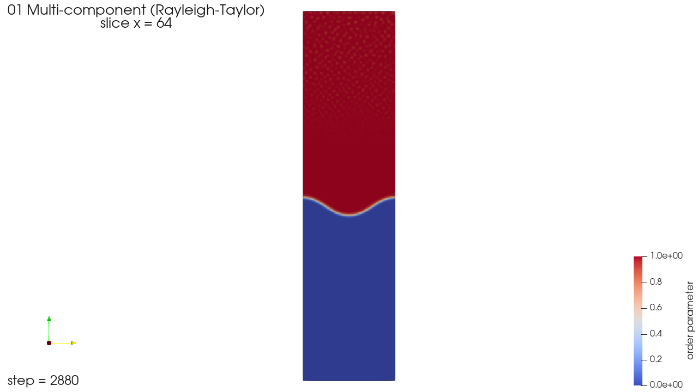

# 01 다성분: 2성분 레일리-테일러 불안정

밀도가 다른 두 유체가 위아래로 놓인 상태에서 시작한다. 무거운 유체가 위에 있으므로 경계면이 흔들리며 무거운 유체가 가운데로 처지기 시작한다. 다성분 해석기(`solver_type: "Multi_component"`, 2성분)를 쓰고, 실행 파일은 LBM이다.



[`preview.mp4`](preview.mp4)는 짧은 실행의 저장 간격(320 스텝)으로 2,880 스텝까지 10장을 이은 영상이다.

## 파일

| 파일 | 내용 |
| --- | --- |
| `01_multi_component_short.json` | 짧은 실행. 640 스텝, 320 스텝마다 저장 |
| `01_multi_component.json` | 원래 길이. 13,120 스텝, 320 스텝마다 저장 |
| `RTI_region.stl` | 처음에 무거운 유체(`high_density_fluid`)가 차지하는 영역 |

계산 영역은 x·y 방향 주기 경계, 위아래(z) 벽이다. 입력은 IITP 2024 테스트 시나리오다.

## 실행

```powershell
pwsh -File scripts\run_case.ps1 examples\01_multi_component\01_multi_component_short.json
```

```bash
bash scripts/run_case.sh examples/01_multi_component/01_multi_component_short.json
```

## 시간과 결과 크기

| 입력 | 시간 | 결과 |
| --- | --- | --- |
| 짧은 실행 | 91초 | 4.2 GB (재시작 파일 2.2 GB 포함) |
| 원래 길이 | 약 18분 (추정) | 저장 42회, VTU 약 29 GB (추정) |

저장 1회의 VTU가 약 690 MB다. 그중 약 70%는 저장마다 다시 쓰는 격자 구조라서, 저장 항목을 줄여도 크기가 크게 줄지 않는다.

## 결과에서 볼 것

`order_parameter1`이 성분 분율이다. 무거운 유체가 1, 가벼운 유체가 0이다. 미리보기처럼 x = 64 수직 단면을 잘라, 경계면이 가운데부터 아래로 처지는 모양을 보면 된다.
