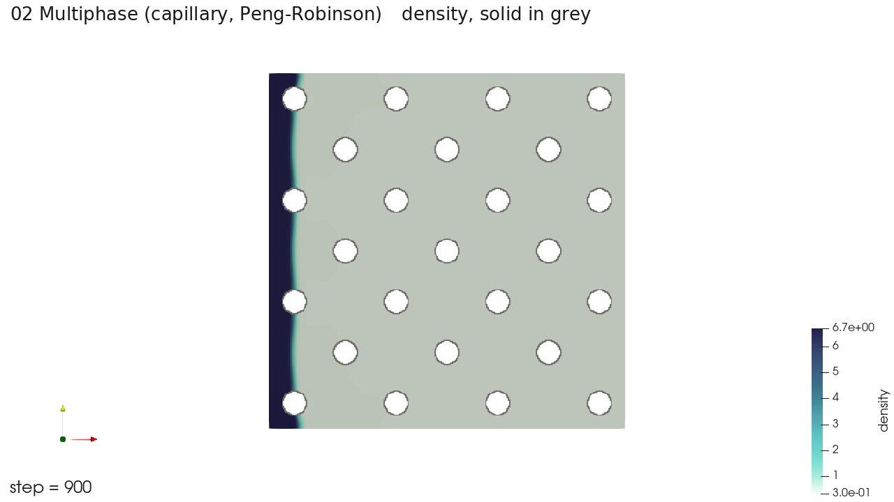

# 02 다상: 고체 벽 옆 액체층

액체와 기체가 함께 있는 계에서 고체 벽 옆의 액체층이 어떻게 변하는지 푼다. 다상 해석기(`solver_type: "multiphase"`)를 쓰고, 실행 파일은 LBM이다. 상태방정식은 Peng-Robinson이다.



[`preview.mp4`](preview.mp4)는 100 스텝 간격으로 900 스텝까지 10장을 이은 영상이다. 왼쪽 벽의 액체층이 조금씩 두꺼워지며, 이 구간에서는 변화가 작다.

## 파일

| 파일 | 내용 |
| --- | --- |
| `02_multiphase_short.json` | 짧은 실행. 200 스텝, 100 스텝마다 저장 |
| `02_multiphase.json` | 원래 길이. 100,000 스텝, 100 스텝마다 저장 |
| `corrected_left.stl` | 처음에 액체(`high_density_fluid`)가 차지하는 영역 |
| `solid.stl` | 고정 고체 영역 |

경계는 x 방향 입구와 출구, y·z 방향 주기 경계다. 모세관수 Ca = 0.0091 조건이다.

## 실행

```powershell
pwsh -File scripts\run_case.ps1 examples\02_multiphase\02_multiphase_short.json
```

```bash
bash scripts/run_case.sh examples/02_multiphase/02_multiphase_short.json
```

## 시간과 결과 크기

| 입력 | 시간 | 결과 |
| --- | --- | --- |
| 짧은 실행 | 10초 | 0.09 GB |
| 원래 길이 | - | 저장 1,001회, 약 10.6 GB (추정) |

원래 길이는 저장이 1,001회라 결과가 크다. 필요한 구간만 보려면 JSON의 `result_report.save_time_interval`을 늘린다.

## 결과에서 볼 것

`density`로 액체와 기체를 구분한다. 로그에 `averaged_vel = -nan` 줄이 찍히는데, 진단용 출력이며 결과 파일에는 NaN이 없다. 실행 스크립트도 이 줄 때문에 실패로 판정하지 않는다.
