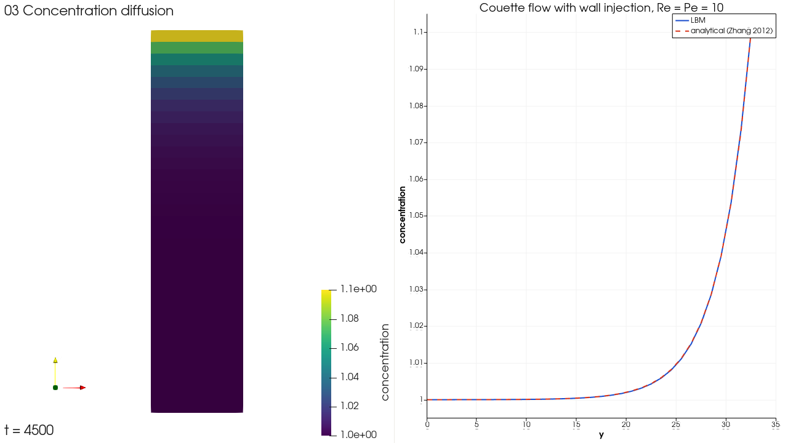

# 03 농도확산: 벽 주입이 있는 Couette 흐름

해석해가 있는 문제로 농도확산 해석기를 확인하는 예제다. 문제는 Zhang, Shi, Guo, Chai & Lu (2012), "General bounce-back scheme for concentration boundary condition in the lattice-Boltzmann method", *Physical Review E* 85, 016701의 III.B절에서 가져왔다. 농도확산 해석기(`solver_type: "concentration_diffusion"`)를 쓰고, 실행 파일은 LBM이다.



## 문제

두 평판 사이의 흐름이다. 위 벽은 속도 Ut로 움직이고 농도가 Ct = 1.1로 고정된다. 아래 벽은 정지해 있고 농도가 Cb = 1.0으로 고정된다. 아래 벽에서 속도 v0로 유체가 들어와 위 벽으로 빠져나간다. 정상 상태 해는 다음과 같다(H는 두 벽 사이 거리, ΔC = Ct − Cb).

```text
u(y) = Ut (exp(Re·y/H) − 1) / (exp(Re) − 1)
C(y) = Cb + ΔC (exp(Pe·y/H) − 1) / (exp(Pe) − 1)
```

해석기에는 고체벽에 농도를 고정하는 경계조건이 없다. 그래서 위아래 벽을 `inlet` 경계(평형분포로 속도와 농도를 지정)로 두었다. 아래는 속도 (0, v0, 0)과 C = 1.0, 위는 (Ut, v0, 0)과 C = 1.1이다. x·z 방향은 주기 경계다. `inlet` 값은 경계 셀 중심에서 맞으므로, 두 경계 셀 중심 사이가 정확히 H가 되도록 영역 높이를 H + dx로 잡았다. Ut = v0 = 0.5, H = 32다.

## 파일

| 파일 | 내용 |
| --- | --- |
| `03_concentration_diffusion.json` | Re = Pe = 10. 20,000 스텝 (원래 길이도 1분 안에 끝남) |
| `variants/` | 비교용 4개 조건 (아래 표) |

STL은 쓰지 않는다. 계산 영역은 8 × (H + dx) × dx 상자다.

## 실행

```powershell
pwsh -File scripts\run_case.ps1 examples\03_concentration_diffusion\03_concentration_diffusion.json
```

```bash
bash scripts/run_case.sh examples/03_concentration_diffusion/03_concentration_diffusion.json
```

13~41초가 걸리고 결과는 0.5 MB다. 41초는 GPU 코드 컴파일이 들어간 첫 실행이다.

## 해석해와의 비교

정상 상태 결과를 y별로 평균해 해석해와 비교했다. E_u, E_C는 논문 Table I과 같은 상대 오차 정의다.

| 조건 | 높이 셀 수 | E_u | E_C |
| --- | --- | --- | --- |
| Re = Pe = 10 (`03_concentration_diffusion.json`) | 32 | 4.8e-3 | 3.2e-4 |
| Re = Pe = 10, smagorinsky 난류 모델 | 32 | 5.1e-3 | 3.5e-4 |
| Re = 20, Pe = 5 | 32 | 1.1e-1 | 6.1e-3 |
| Re = 20, Pe = 5 | 64 | 6.6e-2 | 3.2e-3 |
| Re = 20, Pe = 5 | 128 | 3.7e-2 | 1.6e-3 |

Re = Pe = 10 조건의 오차는 논문 Table I(H/40에서 E_C 6.3e-4, E_u 6.4e-3)보다 작다.

Re = 20, Pe = 5에서는 격자를 반으로 줄일 때마다 오차가 거의 절반이 된다. 즉 1차 수렴이다. 논문의 경계조건은 2차 정확도였다. 이 차이는 `inlet` 경계가 평형분포로 값을 정하면서 비평형 성분을 버리기 때문으로 본다. 이완시간이 크고 경계 근처 기울기가 클수록 오차가 커진다.
