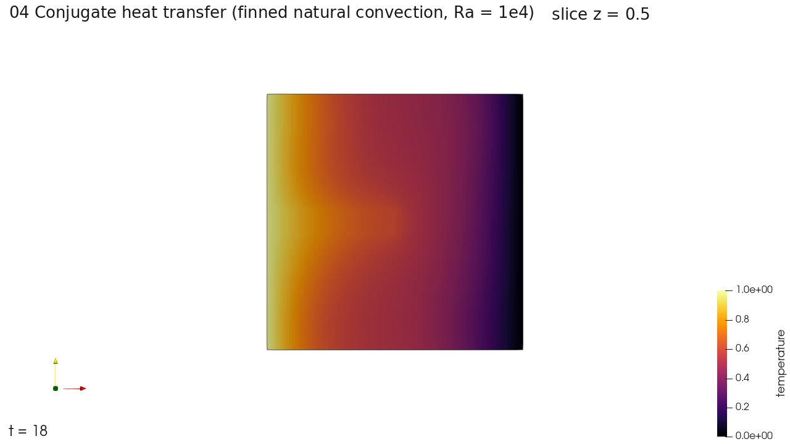

# 04 복합 열전달: 핀이 달린 공동의 자연대류

닫힌 공동 안에서 뜨거운 벽과 고체 핀의 열이 공기로 퍼지며 자연대류가 생기는 과정을 푼다. 고체(핀) 안의 열전도와 공기 쪽의 열 대류를 함께 계산하는 공액 열전달 문제다. 복합 열전달 해석기(`solver_type: "thermal"`)를 쓰고, 실행 파일은 LBM이다. 입력은 공인시험 시나리오 HT-001이다.



[`preview.mp4`](preview.mp4)는 시간 2마다 저장한 결과를 18까지 10장 이은 영상이다. 이 구간은 아직 전도가 주로 일어나는 초기 단계다.

## 파일

| 파일 | 내용 |
| --- | --- |
| `04_conjugate_heat_transfer_short.json` | 짧은 실행. 1,280 스텝(시간 4), 시간 2마다 저장 |
| `04_conjugate_heat_transfer.json` | 원래 길이. 64,000 스텝(시간 200), 시간 2마다 저장 |
| `CHT_natural_convection_in_a_finned.stl` | 핀(공액 열전달 고체 영역) |
| `natural_convection_MB.stl` | 격자를 한 단계 더 잘게 나누는 영역 |

격자는 2단계다. 모든 바깥 경계가 벽이다.

## 실행

```powershell
pwsh -File scripts\run_case.ps1 examples\04_conjugate_heat_transfer\04_conjugate_heat_transfer_short.json
```

```bash
bash scripts/run_case.sh examples/04_conjugate_heat_transfer/04_conjugate_heat_transfer_short.json
```

## 시간과 결과 크기

| 입력 | 시간 | 결과 |
| --- | --- | --- |
| 짧은 실행 | 57초 | 1.4 GB (재시작 파일 0.4 GB 포함) |
| 원래 길이 | 40분 | 저장 101회, 31.3 GB (재시작 파일 0.44 GB 포함) |

## 검증

원래 길이 결과로 사전 자체 시험의 판정 항목 5개를 계산했고, 5개 모두 기준을 통과했다. 기준 해는 상용 해석 결과이며 이 저장소에는 넣지 않았다. 항목별 결과는 [`doc/validation.md`](../../doc/validation.md)에 있다.
