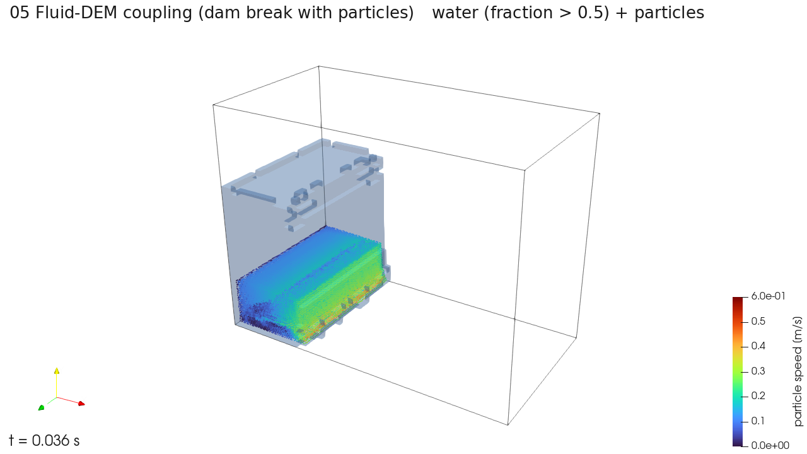

# 05 유체-DEM 연성: 입자가 섞인 댐 붕괴

물기둥이 무너지며 흘러가는 동안 바닥의 입자들이 물에 밀려 움직이는 과정을 푼다. 물은 격자 볼츠만 자유수면 모델로, 입자는 DEM(이산 요소법)으로 계산하고, 둘 사이에 힘을 주고받는다. 유체-DEM 연성 해석기(`solver_type: "free_surface"`와 입자 설정)를 쓰고, 실행 파일은 LBM_DEM이다. 입력은 공인시험 시나리오 FD-001이다.



[`preview.mp4`](preview.mp4)는 0.004초 간격으로 0.036초까지 10장을 이은 영상이다. 물기둥이 무너지기 시작하고 입자 속도가 0.4 m/s 안팎까지 오른다.

## 파일

| 파일 | 내용 |
| --- | --- |
| `05_fluid_dem_short.json` | 짧은 실행. 200 스텝(0.02초), 0.004초마다 저장 |
| `05_fluid_dem.json` | 원래 길이. 2,000 스텝(0.2초), 0.004초마다 저장 |
| `water.stl` | 처음 물기둥 영역 |
| `wall.stl` | 벽을 이루는 고정 입자 영역 |
| `granular.stl` | 처음 입자 덩어리 영역 |

## 실행

```powershell
pwsh -File scripts\run_case.ps1 examples\05_fluid_dem\05_fluid_dem_short.json
```

```bash
bash scripts/run_case.sh examples/05_fluid_dem/05_fluid_dem_short.json
```

## 시간과 결과 크기

| 입력 | 시간 | 결과 |
| --- | --- | --- |
| 짧은 실행 | 16초 | 0.4 GB (재시작 파일 0.3 GB 포함) |
| 원래 길이 | 약 1분 (추정) | - |

## 결과에서 볼 것

격자 결과(`.vtm`)의 `fraction`이 0.5보다 큰 셀이 물이다. 입자는 `<title>_grid1_<n>.vtk`에, 벽을 이루는 고정 입자는 0번 저장의 `<title>_grid0_0.vtk`에 있다.

LBM_DEM은 계산이 발산해도 종료 코드 0으로 끝날 수 있다. 실행 스크립트는 로그에 `nan`이나 `inf`가 있으면 실패로 판정한다. 스크립트 없이 돌렸다면 `run.log`에서 같은 내용을 확인한다.
