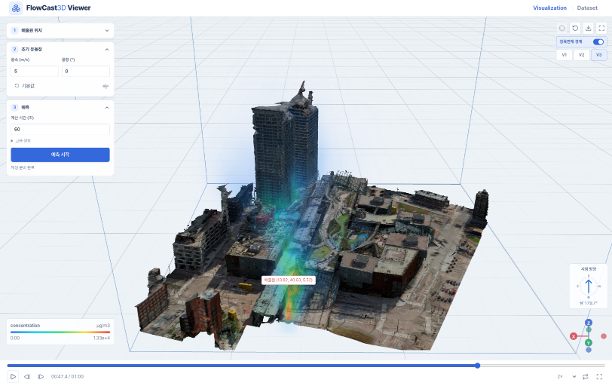
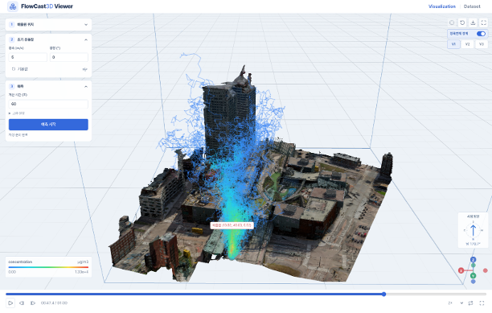
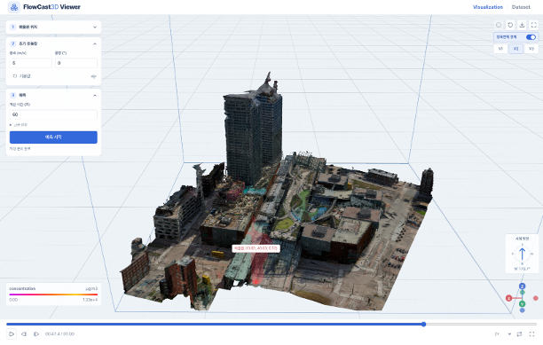

# Digital Twin AI - FlowCast3D

*본 프로젝트는 정보통신기획평가원의 지원을 받아 개발된 딥러닝 기반 3차원 유동해석 통합 SW 패키지입니다.*


|  |  |  |
| :-----------------------------------------------------------: | :-------------------------------------------------------: | :-------------------------------------------------------: |


## Getting Started

### Dependencies

- Ubuntu 20.04 LTS 이상
- GNU Make
- Docker Engine 24.0.7 이상, Docker Compose v2.27.1 이상
- NVIDIA Driver 555.58.02 이상 및 NVIDIA Container Toolkit
- VRAM 8GB / RAM 32GB 이상

### Setup and Usage

1. Git Clone

```bash
# FeDiT 레포지토리 다운로드 및 폴더 이동
git clone https://github.com/etri/FeDiT.git
cd FeDiT/OSFW/DTAI_m2m/Source/3D_CFD/
```

2. Download Model and Data

- Model Weight [[Download](https://drive.google.com/drive/folders/1kcH96kYMLVYtbYyeOqn7_mtnd9-39apO?usp=sharing)]

```
# Copy & Paste
# Location : services/flowcast3d-model/model_repository/flowcast3d/1/
```

- Model Training Dataset [[Download](https://drive.google.com/drive/folders/1wq1Jx4WtZDrGUEEQCObIlBGgAG3hEP3_?usp=sharing)] // Generated using OpenFOAM and Kalasatama 3D spatial data

```
# Copy & Paste
# Location : services/flowcast3d-trainer/data/preprocessed/
```

- 3D City(Kalasatama, Helsinki) Data [[Download](https://drive.google.com/drive/folders/1fHvOtxu5XLIDJqv4486bOC6HfByYu5pR?usp=sharing)]

```
# Copy & Paste
# Location : services/flowcast3d-db/data/
```

\* (Optional) Raw Dataset about Model Training Dataset [[Download](https://drive.google.com/drive/folders/1THi0M-7qrRb1hQkQWnu2EUov9m70nZZX?usp=sharing)] 

3. Copy and Write env file

```bash
# env file 생성
cp .env.template .env
# env file 작성 (실행 환경에 맞게 작성 필요) * DB PW & API KEY 설정 필수
# Ex) MONGO_PASSWORD=1234
# FLOWCAST_API_KEY는 공백 없는 출력 가능한 ASCII 문자 32자 이상으로 설정
# 아래 명령으로 생성한 64자리 값을 .env의 FLOWCAST_API_KEY에 입력
openssl rand -hex 32
```

4. Build and Start

- Full Build

```bash
# FlowCast3D 전체 서비스 빌드 및 시작
make up

# FlowCast3D 전체 서비스 종료
make down

## .env 또는 서버 설정 변경 반영
## 포트 매핑 변경은 컨테이너 재생성 필요
DOCKER_BUILDKIT=1 docker compose --env-file .env up -d --build
```

- Only API &amp; Model Inference (Viewer, Trainer, DB 제외)

```bash
# FlowCast3D API & Inference 서비스 빌드 및 시작
make standalone-up

# FlowCast3D API & Inference 서비스 종료
make standalone-down
```

5. Connect to FlowCast3D Viewer

```
# FlowCast3D Viewer 접속 주소 (로컬호스트 전용)
http://localhost:[FLOWCAST_VIEWER_PORT] # (Default: 8090)
```

6. API Test

- Endpoint

```bash
# FlowCast3D API Endpoint의 포트번호는 env file 설정 값에 따라 달라질 수 있음
# FLOWCAST_3D_API_HOST는 서버 바인딩 주소이며 0.0.0.0은 모든 인터페이스를 의미
# 접속할 때는 localhost 또는 실제 서버 IP를 사용
# 3D 유동장 예측 API Endpoint
http://localhost:[FLOWCAST_3D_API_PORT]/v1/predict # (Default: 3001)
# 3D 유동장 예측 결과 시각화 API Endpoint
http://localhost:[FLOWCAST_3D_API_PORT]/v1/visualize # (Default: 3001)
```

- Example of `/v1/predict`  (Python)

```python
import json
from pathlib import Path

import requests

# Request
input_path = Path("building.obj")

api_url = "http://localhost:3001/v1/predict"
headers = {"Authorization": "Bearer YOUR_API_KEY"}
wind = {"speed": 3.0, "direction": 270.0}

if input_path is not None:
    # 1. 파일(OBJ, STL, VTK, NPZ) 입력
    with input_path.open("rb") as file:
        response = requests.post(
            api_url,
            headers=headers,
            files={"file": (input_path.name, file)},
            data={
                "wind": json.dumps(wind),
                "options": json.dumps({"grid_shape": [16, 16, 16]}),
            },
            timeout=180,
        )
else:
    # 2. 배열 입력
    building_mask = [
        [
            [int(4 <= x < 8 and 4 <= y < 8 and z < 6) for x in range(16)]
            for y in range(16)
        ]
        for z in range(16)
    ]

    response = requests.post(
        api_url,
        headers=headers,
        json={
            "building_mask": building_mask,
            "grid": {
                "origin": [0.0, 0.0, 0.0],
                "spacing": [2.0, 2.0, 2.0],
            },
            "wind": wind,
        },
        timeout=180,
    )

# Response
response.raise_for_status()
prediction = response.json()
Path("prediction.json").write_text(
    json.dumps(prediction), encoding="utf-8"
)

print(f"HTTP {response.status_code}")
print(json.dumps({
    key: prediction[key]
    for key in ("schema", "axis_order", "grid", "wind", "units")
}, indent=2))
```

- Example of `/v1/visualize`  (Python)

```python
import json
from pathlib import Path

import requests

# Request
output_format = "png"  # png, gif, mp4 중 선택

prediction = json.loads(
    Path("prediction.json").read_text(encoding="utf-8") # /v1/predict response
)

response = requests.post(
    "http://localhost:3001/v1/visualize",
    headers={"Authorization": "Bearer YOUR_API_KEY"},
    json={
        "prediction": prediction,
        "format": output_format,
        "field": "speed",
        "representation": "slice",
        "axis": "z",
        "width": 1280,
        "height": 720,
    },
    timeout=180,
)

# Response
response.raise_for_status()

output_path = Path(f"prediction.{output_format}")
output_path.write_bytes(response.content)

print(f"HTTP {response.status_code}")
print(f"Content-Type: {response.headers['Content-Type']}")
print(f"Saved: {output_path}")
```

8. (Optional) Model Training

```bash
# 프로젝트 루트에서 실행
# 학습 데이터: services/flowcast3d-trainer/data/preprocessed
# 학습 설정: services/flowcast3d-trainer/configs/collect.yaml // default.yaml은 기본 적용됨
# 동작 확인 시 --epochs 2로 변경
DOCKER_BUILDKIT=1 docker compose --env-file .env --profile training \
  run --rm --no-deps --build flowcast3d-trainer \
  python main.py train \
    --config configs/collect.yaml \
    --epochs 3000 \
    --device auto
```

## License

Copyright (c) 2026 SmartM2M Inc.

This project is licensed under the [GNU Lesser General Public License version 2.1](LICENSE).

See [NOTICE](NOTICE) for third-party notices.

## Acknowledgments

This work was supported by Institute of Information &amp; communications Technology Planning &amp; Evaluation (IITP) grant funded by the Korea government(MSIT) (Development of an intelligent digital twin federation core technology) .